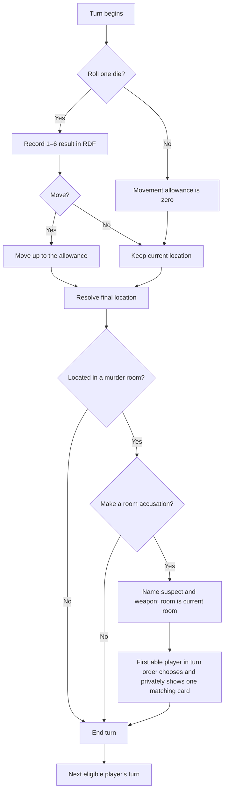

# Everything's Sus — Game Rules

**Rules status:** Initial implementation draft  
**Players:** 3–6  
**Mode:** Pass-and-play or local multi-device  
**Objective:** Identify the concealed suspect, weapon, and room.

## 1. The mystery

A crime has been committed somewhere on the estate. One suspect, one weapon, and one room are sealed as the solution. The remaining cards are dealt among the detectives.

Win by making the first correct accusation naming all three solution cards.

## 2. Contents

### Suspects

- Mrs. Eggshell — white
- Lt. Marinara — red
- Ms. Peach — orange
- Mrs. Mint — green
- Prof. Mulberry — purple
- Mr. Brown — brown

### Weapons

- Shovel
- Baseball bat
- Pistol
- Rope
- Knife
- Electric guitar

### Rooms

- Ballroom
- Living Room
- Dining Room
- Kitchen
- Study
- Game Room
- Screened-in Porch
- Greenhouse
- Swimming Pool Room

The deck contains 21 unique cards: six suspects, six weapons, and nine rooms. The board contains the nine card rooms, connecting passages, the shared Foyer starting area, and any secret passages shown on the board. The Foyer is a board location but is not a room card and cannot be named in a room accusation or final accusation.

## 3. Choose how to play

### Pass-and-play

Use one device for the board and every private hand. Before private information appears, the screen names the intended player. That player confirms, reviews their cards or notebook, and conceals the screen before passing it on.

This prevents accidental viewing during ordinary play, but everyone’s information still exists on the same device.

### Local multi-device

Use one host device for setup, the board, turns, die rolls, room accusations, and final accusations. Each player opens the player page on a personal device and enters the table code, their chosen suspect, and private five-letter hand code shown by the host. For faster setup, selecting a player's access row on the host opens that suspect's portrait and a QR code containing the same player-scoped access details; scanning it opens and fills the player page automatically.

The player page contains that player’s starting hand and private detective notebook. It does not automatically receive later board changes; players follow the host screen and update their notebooks themselves.

The short table code identifies the game but contains no deal or solution. A private hand code reconstructs only its chosen suspect’s starting cards. Keep that five-letter code private because anyone who sees it together with the access details can display that hand.

## 4. Setup

1. Choose pass-and-play or local multi-device.
2. On the setup screen, select three to six suspect portraits in the desired turn order. Selecting a portrait marks it active; selecting it again removes it. The number selected is the player count, so duplicate suspects are impossible.
3. The game randomly selects one suspect, one weapon, and one room for the sealed solution.
4. The remaining 18 cards are shuffled and dealt one at a time. Some players may receive one more card than others.
5. In pass-and-play, each player privately reviews their hand in turn.
6. In multi-device play, the host presents a separate five-letter hand code to each player. Each player enters only their own code and access details.
7. Randomly assign the selected player-suspects without replacement among the six nonblocking Foyer start sites marked internally as α, β, γ, δ, ε, and ζ. The assignment is independent of player selection and turn order; α is not automatically the first player. Unselected suspects begin in an off-board reserve until named in a room accusation. Place each selected suspect's token on the site occupied by the person it represents.
8. The first selected portrait takes the first turn. Play then follows the generated turn order.

The host publishes a cryptographic commitment to the sealed solution during setup. When the game ends, the revealed solution can be checked against that original commitment.

## 5. Turn cycle

Rolling, movement, and a room accusation are each optional. A player may end their turn without rolling; roll and decline to move; move fewer paces than available; decline to accuse while in a room; or end immediately. A room accusation, when made, is the last voluntary action of the turn. A separate **final accusation** is the attempt to solve and win the game.

## 6. Roll and move

The player may roll one fair six-sided die once on the host or shared page. Each result from 1 through 6 has equal probability. The result is recorded in the game state and becomes that turn's maximum movement allowance. Rolling does not require movement, and a player may stop before spending every pace.

- From a hallway or Foyer space, the board highlights each legal adjacent destination. Movement choices are made directly on those nearby board spaces rather than through ambiguous directional controls in a separate panel. Diagonal movement is never offered.
- Moving to an orthogonally adjacent walkable space normally costs 1 pace.
- Crossing an open entryway costs 2 paces total. An entryway is simply an unobstructed gap in the wall: it has no door, gate, curtain, or other physical barrier.
- Crossing a doorway costs 3 paces total. A paired or double door is one doorway crossing, not two.
- The special crossing cost replaces the ordinary 1-pace step cost; it is not added to it.
- A player may cross no more than one marked ingress or egress during a turn. A doorway and an open entryway both count toward this limit.
- A player who cannot pay the complete crossing cost may not cross that boundary.
- Movement is orthogonal unless the board explicitly shows another connection.
- You may not enter the same passage space twice during one move.
- A hallway or Foyer space may contain at most one person. You may not enter or pass through one occupied by another person.
- Entering a room ends movement immediately. Exact count is not required to enter it, but the player must still have enough paces to pay the complete ingress cost.
- A player who begins a turn in a room may leave through one marked egress and continue through passage spaces, but may not enter another room during that turn because that would cross a second ingress/egress.
- A player who begins in a corner room may use its shown secret passage before or after rolling, provided they have not left that room. Using it discards any unspent paces, moves directly to the paired room, and ends movement.

When a person is adjacent to a marked room entrance, the room itself becomes a board control and reports the 2- or 3-pace cost. Unavailable destinations are not duplicated in the side panel. The Greenhouse has a 3-pace doorway from hallway site S4, and the Kitchen has a 2-pace open entryway from hallway sites S8/S9, aligned across the hall from the Ballroom opening, in addition to its connection with the Dining Room.

Each room is one location rather than a collection of movement spaces. It may contain zero through six suspect people, and the board must be able to display all six corresponding tokens in one room. Weapon pieces do not count against this person capacity.

The game state records where the suspect person is located. The token is only the visible representation of that person; moving the token updates the person's location rather than asserting that the person and token are identical.

The displayed die uses the same accessible SVG face design as Poker Dice, but it is a single non-holdable movement die.

Every walkable hallway and Foyer site is visibly outlined as a square on the finished board. These subtle grid lines are part of the player view so players can count one-pace orthogonal routes before rolling. Room interiors are not subdivided because each room is one multiply occupiable site.

The four literal corner rooms have diagonal secret passages: **Swimming Pool Room ↔ Dining Room** and **Greenhouse ↔ Living Room**. When the active person is in a corner room, that room's corner-arrow marker is the passage control. It remains clickable after a die roll as well as before one. Passage use moves the person directly to the paired room, discards any remaining paces, and ends movement for the turn.

### Estate layout

The intended floorplan is organized in three broad bands:

- Back: Swimming Pool Room, Screened-in Porch, and Greenhouse.
- Middle: a side-by-side Study and Game Room on the left, Ballroom in the center, and Kitchen above Dining Room on the right.
- Front: Living Room across the lower-left, the central Foyer, and Dining Room extending through the lower-right.

The minimum room/zone connections are:

- Study—Living Room;
- Game Room—Study, Game Room—Living Room, and Game Room—Ballroom;
- Swimming Pool Room—Screened-in Porch;
- Screened-in Porch—Greenhouse and Screened-in Porch—Ballroom;
- Greenhouse—Kitchen;
- Kitchen—Ballroom and Kitchen—Dining Room;
- Ballroom—Dining Room; and
- Foyer—Living Room, Foyer—Ballroom, and Foyer—Dining Room.

The underlying board model is an exact 26-column by 18-row topology, but its coordinate labels and specification colors are not part of the player-facing artwork. Hallways should appear as an off-white, tan, or gray mansion floor rather than black. Stairs should use a clear top-down stair illustration rather than a flat gray block. Room illustrations are clipped to their exact room boundaries; in particular, Swimming Pool Room artwork must not spill into hallway spaces J4 or J5. The source plan's solid red marks identify doors and its dashed marks identify open entryways. On the finished board a door is a visible fixture, while an entryway is rendered only as a clean, unobstructed break in the wall.

The finished board should retain the illustrated estate aesthetic, outer mansion walls, and surrounding lawn. Individually generated room artwork is composed beneath a separate topology and interaction layer so changing the art cannot change legal spaces or movement.

## 7. Room accusations and evidence

If your suspect person ends movement in one of the nine murder rooms—or began the turn there and did not leave—you may make one optional room accusation consisting of:

- any suspect;
- any weapon; and
- the room the person currently occupies.

The accusation form displays the current room as a fixed third element beside the suspect and weapon selectors, so the complete classic formula is visible before confirmation. Once announced, the complete suspect–weapon–room accusation is recorded in the public change log.

Move the named suspect person and weapon into that room in the game state, then render their pieces there. The moved suspect person remains located in that room until moved normally or named by another room accusation.

Beginning with the next player in the fixed turn order and wrapping around as needed, each other player checks whether their hand contains at least one card named by the accusation.

- A player with no matching card declares that they cannot refute, and the request passes clockwise.
- The first player with one or more matching cards must privately show exactly one to the accuser. If they hold multiple matching cards, that player chooses which one to show.
- Refutation stops after one card is shown.
- Nobody else may see which card was shown.

In pass-and-play, use the private reveal screen. In multi-device play, the refuting player selects the card on their own device and physically shows that device only to the accuser. The accuser records the information in their notebook. If no card is available to show—whether because the accuser holds it, it is in the sealed solution, or no other player can refute—play is not blocked. The active player may always end the turn from the refutation screen.

## 8. Detective notebook

Your notebook is private. It may track:

- cards in your hand;
- cards shown to you;
- deductions about other players;
- freeform notes.

Notebook marks are aids, not authoritative game state. The game does not make deductions or correct mistaken notes.

The local sleuth sheet always preserves at least one unchecked possibility in each category. When only one suspect, weapon, or room remains, that row is highlighted and its checkbox is disabled. Unchecking another row makes it editable again. This is a notebook safeguard, not a claim by the authoritative host that the highlighted card is correct.

## 9. Final accusations

To distinguish this game-ending claim from the refutable action in Section 7, this section calls it a **final accusation**. A final accusation names a suspect, weapon, and room and is checked directly against the sealed solution rather than offered to other players for evidence.

A player may make a final accusation only while their suspect person is located on one of the walkable Foyer squares. The representing token must therefore visibly be in the Foyer. Being in a room adjacent to the Foyer, on the stairs, or in another hallway site is not sufficient. The player may accuse from the Foyer at any otherwise voluntary decision point and need not spend all remaining paces first.

The host compares the final accusation with the sealed solution without first displaying the solution.

- If all three cards match, an envelope-style reveal presents the suspect, weapon, and room cards one at a time; the setup commitment is verified, and the accuser wins.
- If any card differs, the final accusation fails. The accuser is eliminated from taking turns, moving, making room accusations, and making final accusations.
- An eliminated player keeps their cards and must continue refuting room accusations when able.

If every player but one is eliminated, the remaining eligible player does not automatically win; they must still make a correct accusation. If every player becomes eliminated, use the same three-card reveal, verify the solution, and record that the mystery defeated the table. A failed accusation never reveals any solution card while another player remains eligible.

Every suspect token carries a short visible name label. Pointing to it with a mouse, focusing it with a keyboard, or selecting it on a touchscreen shows the larger portrait and full suspect name without moving the token.

## 10. Information and fairness

- Do not inspect another player’s device, hand code, or saved data.
- Keep private hand codes secret.
- The host device contains the full solution and every hand; the host operator is trusted not to inspect developer tools or storage.
- Pass-and-play concealment is a social privacy aid, not protection against deliberate device inspection.
- A player hand code cannot be revoked after it has been copied in the zero-server version.

## 11. Saving

The host may save the complete game locally. Player devices save only their own hand, notebook, and public game identification. Restoring the host does not automatically update player devices; starting hands remain valid because cards do not transfer during play.
