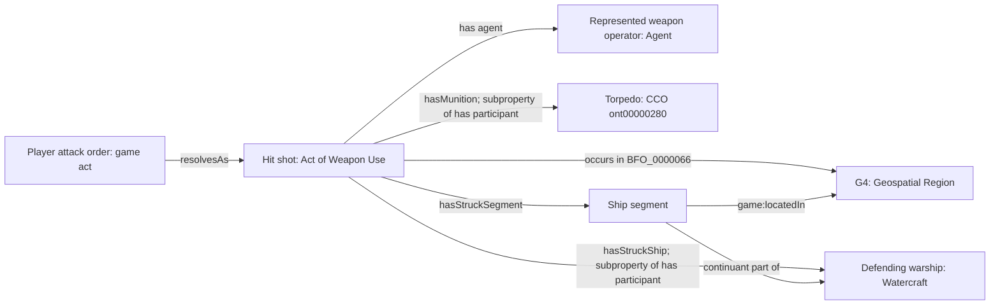
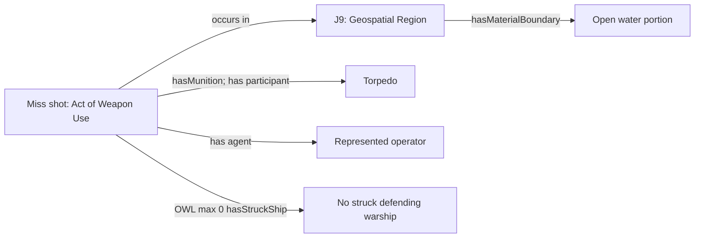
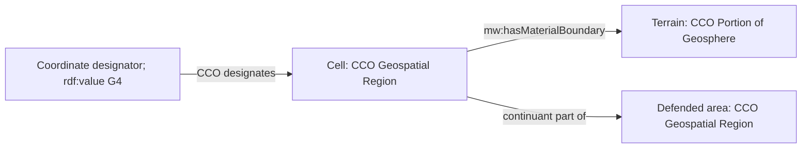
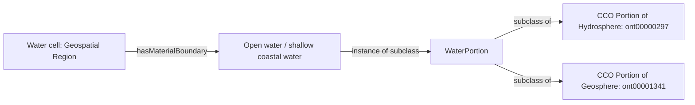
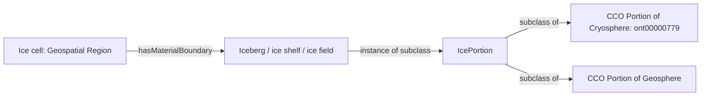
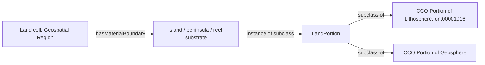
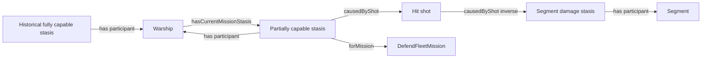
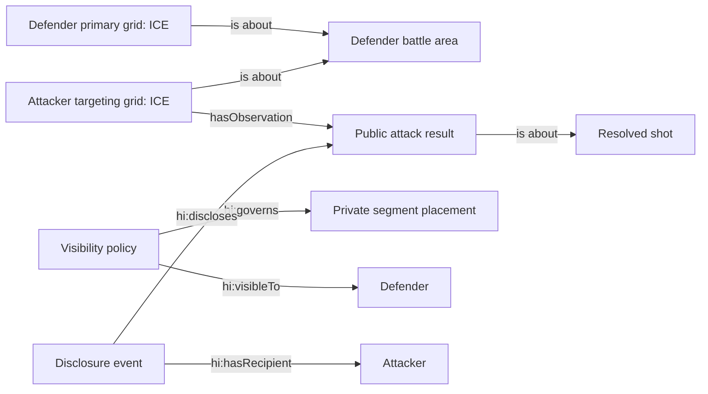

# Maritime Warship ontology and design patterns

[MaritimeWarshipOntology.ttl](MaritimeWarshipOntology.ttl) extends the existing [Game Ontology](GameOntology.ttl) and [Hidden Information Ontology](HiddenInformationOntology.ttl). [MaritimeWarshipExamples.ttl](MaritimeWarshipExamples.ttl) supplies instance patterns. Namespace: `https://w3id.org/ontologized-entertainment/maritime-warship/` (`mw:`).

This is the initial domain data model, not an implementation of the app. It follows the Maritime Warship specification subject to the boilerplate's canonical RDF, ordinary current-state triples, retained historical processes, and viewer-scoped projections. No named graphs or RDF reification are required.

## Entity inventory and reuse

| Entities | Alignment and modeling choice |
|---|---|
| Ruleset, running match | `game:Game` (CCO ICE), `mw:MaritimeSession` under `game:GameSession` (BFO Process) |
| Players, current player, winner | CCO Agent `ont00001017`; reuse `game:PlayerRole`, `CurrentPlayerRole`, `WinnerRole`; no need for a new human subclass |
| Fleet | `mw:Fleet` directly under BFO Object Aggregate (`obo:BFO_0000027`); distinct ships use `obo:BFO_0000129` |
| Carrier, battleship, cruiser, submarine, destroyer | Local subclasses of `mw:Warship`, under CCO Watercraft `ont00000440`; two carriers are two individuals, not quantity assertions |
| Individually damageable segments | `mw:ShipSegment`, BFO fiat object part `BFO_0000024`; `BFO_0000176` relates each to its ship; `game:locatedIn` relates each to one cell |
| Defended area, cells | CCO Geospatial Region (`cco:ont00000472`), a BFO Site; defended areas and cells are individuals distinguished by labels, scoped coordinates, parthood and their relations |
| Primary and targeting grids | ICE records about a battle area using CCO `is about` (`ont00001808`); both reference the same underlying sites |
| Coordinates, row/column values | `mw:CoordinateDesignator`, `rdf:value "G4"`, CCO `designates` (`ont00001916`) the cell; identifier scoped to battle area |
| Open and shallow coastal water | Local `WaterPortion` subclasses; reuse Portion of Hydrosphere `ont00000297` |
| Island, peninsula, reef substrate | Local `LandPortion` subclasses; reuse Portion of Lithosphere `ont00001016`; living coral is not lithosphere |
| Iceberg, ice shelf, ice field | Local `IcePortion` subclasses; reuse Portion of Cryosphere `ont00000779`. An ice shelf is attached, whereas an iceberg is detached |
| General terrain | Water, land and ice portions also subclass Portion of Geosphere `ont00001341`. The bundled CCO sphere classes are not themselves asserted below that class, so these local multiple inheritances are deliberate |
| Obstacle | A terrain individual bearing `mw:ObstacleRole`; role status depends on rules, not merely on a terrain class |
| Torpedo, missile, other ammunition | Reuse CCO Torpedo `ont00000280`, Precision-Guided Missile `ont00001124`, Portion of Ammunition `ont00001150`; a fresh munition individual per shot |
| Weapon, represented operator | CCO Weapon `ont00000445`, CCO Agent; relate shot to operator with `cco:ont00001833` (has agent). A launcher may be a participant, separately from the struck defender |
| Defender reporting | Reuse `hi:DisclosureEvent` for the verbal disclosure. Each device records its own observations locally; `mw:hasLocalPlayer` identifies that journal’s owner |
| Player attack command, placement | `mw:AttackOrder`, `mw:PlacementAct` under `game:GameAct`; distinguish actual player input from represented weapon employment |
| Shot, hit, miss, blocked, glancing miss, sinking hit | CCO Act of Weapon Use `ont00000612` directly; local hit/miss subclasses describe resolved outcomes without an intermediate shot class |
| Salvo | Process whose shots are occurrent parts (`BFO_0000132`); one order resolves one or up to five shots |
| Damage and mission status | CCO Damaged Stasis `ont00001289` directly; ship capability stases specialize fully `ont00000622`, partially `ont00000100`, and non-mission capable `ont00000557` under `ont00001132` |
| Mission | `mw:DefendFleetMission`, a reusable `game:ActionSpecification`; capability is relative to this game mission |
| Feedback | ICE `mw:AttackResult` with Hit, Miss and Sunk result subclasses (Blocked and GlancingMiss retained for legacy records); CCO `is about` links to the shot; a grid has observations |
| Turns and phases | Reuse `game:Turn`, `game:Phase`, `game:hasCurrentPhase`; individuals for setup, placement, combat, completed phases. These classes are temporal intervals, not processes |
| Configuration, custom draft, fleet presets | `mw:MatchConfiguration`, typed parameter specifications with `rdf:value`. Row/column count, obstacle cluster count, climate, fleet composition, ship length, salvo limit, play/preset mode, draft budget, fleet ceiling, fairness tolerance, board seeds |
| Fairness assessment | `mw:PlacementEntropyAssessment`, descriptive ICE about an area and configuration, `rdf:value` the computed legal-placement count; normally derived, optionally retained for audit |
| Visibility, result disclosure, placement commitment | Reuse `hi:VisibilityPolicy`, `hi:DisclosureEvent`, `hi:CommitmentSpecification`; no replacement security vocabulary |
| Cancel, focus, staged targets, graphics, sound, haptics, colors, settings | UI/technical state, not shots or terrain entities; cancellation before commit creates no weapon-use event |
| Save packages, QR/link/code, ciphertext, transaction deltas | Technical transport/persistence artifacts outside the domain model. A code labels a session; it does not retrieve state without a rendezvous service |

## Direct reuse rather than contextual wrapper classes

Use CCO Damaged Stasis (`cco:ont00001289`) and Act of Weapon Use (`cco:ont00000612`) directly. A particular damaged stasis involves a segment through `has participant`; a particular weapon-use act occurs in a target region and involves a munition. These contextual assertions do not require intermediate classes. The target-site, agent, weapon and munition requirements are application validation rules, not additional restrictions on the imported CCO classes.

Fleet directly subclasses BFO Object Aggregate (`obo:BFO_0000027`). Membership uses BFO member part of (`obo:BFO_0000129`) directly. Any one-container requirement belongs to a specific game rule or shape, not a functional property or blanket constraint on all game objects. The shared ontology, dependent ontologies and structural shapes likewise use BFO Object Aggregate and CCO Geospatial Region directly. All defended areas and cells are Geospatial Region individuals. Labels such as "Bob defended area" and "Bob G4" support display; scoped coordinate designators, region parthood and session relationships carry the machine-readable distinctions. Labels do not determine legality or identity.

## Represented world and information records

Material subclasses describe entities **in the game's represented world**. A browser object or RDF node is not literally an ocean or a ship. The graphs, designators and result ICEs provide information about those represented entities. This modeling convention permits CCO watercraft reuse without asserting that a digital icon is a physical watercraft. If physical toy tokens are later modeled, introduce separate game pieces that represent the ships.

## Local knowledge and manual verbal reports

Each device stores its own fleet and its own record of the conversation. Setup-only code/QR/link sharing reconstructs public terrain and rules. There are no further app-to-app messages. Players coordinate readiness and turns verbally; the creator fires first. The attacker explicitly records verbal outgoing outcomes using initially blank controls. The defender confirms incoming coordinates; the app computes and announces the corresponding outcomes from the known local fleet.

Confirmed incoming coordinates resolve against the local fleet and prior damage; incoming hits identify the local material ship and segment. Outgoing Hit reports describe a hit act without inventing a named opponent ship or segment witness. OWL existential restrictions allow such partial descriptions; missing placement triples do not mean the site is empty. An outgoing Sunk report individuates a participating `mw:Warship` in a `mw:SunkStasis`, without specifying its subclass, length, footprint, or correspondence with earlier hits. Hit and Sunk do not require vessel identity disclosure.

The following diagrams show material-world patterns when the relevant participants are known. A local journal may contain only the known portion of such a pattern. Automatic outgoing resolution from opposing fleet positions and pass-and-play are deferred future options, not current modes. Incoming resolution from the local fleet is part of the baseline.

## Hit: weapon use at a site with a ship and munition

The shot is **target-local terminal weapon employment** so its entire extent can occur in the cell under BFO `occurs in`. A launch-to-impact journey would need a larger site and a separate terminal subprocess. The player's issuing an order does not make the player a physical operator at G4.

## Miss: weapon use at a site without a struck ship

In a minimal target-local miss there is no ship participant. A general weapon-use act can still include a **firing** ship, so prohibiting every Watercraft participant would be too strong. `hasStruckShip` specializes BFO `has participant` to identify exactly the participant that distinguishes hit from miss. A missing participant triple alone does not prove a miss under OWL's open-world semantics: the local player must explicitly record the defender’s verbal outcome. Only incoming coordinates can be resolved against a fully known local footprint. The app announces their outcomes after coordinate confirmation; outgoing verbal outcomes must be entered explicitly. The miss restriction states there are zero struck ships. Never classify from a player's redacted projection.

Terrain misses add a terrain participant using BFO `has participant`, but no struck defender. Legacy blocked and glancing-miss records use the same participant pattern. A sinking shot is a hit, with a `SunkResult` rather than an ordinary `HitResult`. Feedback records are information about events, not the events themselves.

## Site materially bounded by geosphere

`mw:hasMaterialBoundary` is a local, explicitly defined relation: terrain **materially bounds the site in part**. A three-dimensional terrain portion is not a two-dimensional BFO fiat boundary. Grid lines are fiat delimitations; they need not be physical walls. No existing BFO relation in the bundled vocabulary expresses this exact terrain-to-site relation; `has material basis` concerns a different pattern and is not reused here. The site is not identical to the water or rock itself.

## Site materially bounded by hydrosphere

## Site materially bounded by cryosphere

The request's “cytosphere” is interpreted as **cryosphere** (frozen water).

Cells can have multiple material boundary portions, for example ice and underlying water. There are no separate water, land or ice cell classes; terrain relations express those distinctions. The rules engine determines which terrain controls placement and attack behavior.

## Site materially bounded by lithosphere

## Damage, capability and history

At setup create one fully capable stasis per ship. A hit adds a segment damage stasis with that segment as participant and the shot as cause. Replace only the ship's `hasCurrentMissionStasis` link when its capability changes; retain old stases and their participants. Each new ship stasis participates with the ship and references `DefendFleetMission`. Some damaged segments means partially capable; all means non-mission capable (sunk). These are explicit game abstractions: physical damage alone does not determine real naval mission capability, and “sunk” here does not assert a physical sinking trajectory.

The ship itself has multiple cells. Do **not** use functional `game:locatedIn` for the whole ship at every footprint cell; use one segment per cell, each part of the ship. Derive the footprint and intact counts from those entities. Duplicate class lengths and sunk booleans are unnecessary.

## Hidden information and grids (reusable future projection pattern)

For a future host-authoritative or pass-and-play extension, visibility policy must cover the private placement relationships and everything that would reconstruct them, including seeds, ship-participant links in shots, damage stases and undisclosed fleet membership. Entity-level `hi:governs` alone does not define safe per-predicate filtering: the projection implementation must specify an allowlist for each viewer and phase. Share result and coordinate records without traversing private participants. Public terrain need not imply public placements. At completion reveal the opponent board through phase-scoped policy. Transport encryption and commitments follow the existing hidden-information specs; a setup seed or URL payload must not expose an opponent's fleet. UI concealment alone provides presentation privacy.

## Application validation and transitions

OWL subclass restrictions express meaning rather than closed-world completeness, turn legality or atomic updates. The app’s JavaScript engine validates the local journal:

1. Two player identities and public defended regions exist; `mw:hasLocalPlayer` identifies one device’s player. Only that player’s fleet and privately placed segments are present. Opponent footprint triples must not be present or reconstructed from the public terrain seed.
2. Dimensions are 8-26. Cells are labeled CCO Geospatial Region individuals with unique scoped coordinate designators, terrain boundaries and orthogonal topology.
3. The local fleet matches the configured 4-7 vessel profile. Each known ship has the prescribed 2-5 individuated segments, one location per placed segment, and one current mission stasis. Unknown enemy segment identities are not invented.
4. Placements are straight, contiguous, nonoverlapping and obstacle-free, with heavy-vessel tropical clearance. Placement locks independently on each device; both players confirm readiness verbally.
5. Terrain pairs have identical obstacle volume and placement entropy within 3%, plus full-fleet feasibility. A point rotation satisfies parity. Private placement randomness is independent of the shared public terrain seed.
6. The local journal tracks alternating outgoing/incoming turns, starting with the creator’s attack. The app cannot verify another device’s readiness, turn or record without communication and does not claim to do so.
7. Standard reporting records one coordinate; salvo reporting records 1-5 distinct unresolved coordinates. Every result must be explicitly selected; cancel leaves RDF unchanged. No damage or result is committed merely by selecting a coordinate.
8. Incoming outcomes are consistency-checked against known local placements and damage. Outgoing outcomes record the verbal claim without inspecting unknown opposing placements. Sunk does not require class/name disclosure. A sunk claim has a participating warship with a non-mission-capable stasis, and no invented footprint.
9. Commit the complete locally recorded batch atomically, retaining historical acts and feedback. Derive own defeat from known damaged segments; derive victory from locally recorded sunk-vessel reports and sufficient hits. Opponent placements remain unknown even at completion.
10. Persist canonical RDF, technical deltas, private RNG and schema/version metadata locally. Setup codes contain only public configuration and terrain seeds; sharing them later never sends current observations or private state. Private local saves are not invitations.

## Sources and version scope

The CCO identifiers and definitions were checked against this repository's bundled [Artifact](ArtifactOntology.ttl), [Event](EventOntology.ttl), [Geospatial](GeospatialOntology.ttl), [Agent](AgentOntology.ttl), [Information Entity](InformationEntityOntology.ttl) and [BFO core](bfo-core.ttl) files. This deliberately targets the app's installed vocabulary. Live dereferencing of the supplied CCO term URLs was unavailable during preparation. No remote ontology download is needed to understand these mappings; a loader should map imported ontology IRIs to the bundled files, following their transitive imports locally.

Requirements: [Maritime Warship](../../../specs/MARITIME_WARSHIP.md), [technical boilerplate](../../../specs/BOILERPLATE_TECHNICAL_SPEC.md), [capability boilerplate](../../../specs/BOILERPLATE_CAPABILITY_SPEC.md). Parameter values use typed information nodes and `rdf:value`; renderer geometry, UI state and technical transport remain outside domain RDF.

The playable result choices are Miss, Hit, and Hit and sunk (stored as `Sunk`). Terrain shots are misses. Legacy Blocked/GlancingMiss classes are retained for reading older records, not offered as current choices. Ending a game records an ended phase without inventing a winner. A local game name reuses `rdfs:label` on the session.
